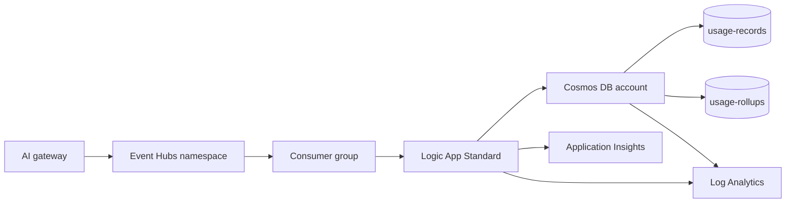

# AI gateway usage data

This scenario creates the infrastructure needed to receive AI gateway usage events, process them with Logic App Standard, and store detailed records and rollups in Cosmos DB. It covers infrastructure only; deployment of the Logic App workflow application is deliberately deferred.

## Architecture



The scenario provisions:

- A resource group and dedicated Log Analytics workspace.
- Application Insights connected to the workspace.
- An Event Hubs namespace, usage event hub, and consumer group.
- A Windows Logic App Standard plan, storage account, and Logic App with a system-assigned identity.
- A Cosmos DB account, SQL database, and containers for usage records and rollups.
- Diagnostic settings for the Logic App and Cosmos DB account.
- Azure RBAC and Cosmos DB data-plane RBAC assignments for the Logic App identity.

## Inputs

The single configuration file is [`configuration.tfvars`](configuration.tfvars). Important settings are:

- `event_hubs`: event hub name, partitions, and retention.
- `event_hub_consumer_groups`: consumer group used by the processor.
- `storage_accounts`: runtime storage for Logic App Standard.
- `service_plans`: Windows Workflow Standard plan.
- `cosmos_dbs`: account authentication, locations, database, containers, diagnostics, and timeouts.
- `logic_app_standard`: runtime identity, static and dynamic application settings, diagnostics, and timeouts.
- `diagnostics_definition` and `diagnostics_destinations`: categories and Log Analytics destination.
- `role_mapping`: Event Hubs and Storage Azure RBAC assignments.
- `cosmosdb_role_mapping`: Cosmos DB data-plane role assignment.

The Cosmos SQL database disables random-name suffixing so its deployed name remains `ai-gateway-usage`, matching `COSMOS_DATABASE_NAME` and the workflow contract.

Dynamic application settings are resolved by the root module from CAF combined objects. For example, the Cosmos endpoint and Event Hub names are read from the created resources rather than duplicated as literals. Dynamic values override a static setting with the same name.

The configuration disables Cosmos DB and Event Hubs local authentication. Workflows therefore require the managed identity and the RBAC assignments in this scenario.

## RBAC

The Logic App system-assigned identity receives:

- `Azure Event Hubs Data Receiver` on the Event Hubs namespace.
- `Storage Blob Data Contributor` and `Storage Queue Data Contributor` on runtime storage.
- `Cosmos DB Built-in Data Contributor` on the Cosmos DB account.

The deployment principal must be able to create Microsoft authorization role assignments. Cosmos data-plane role assignment propagation can take time after the infrastructure plan is completed.

## Diagnostics

The `operations` profiles send:

- Cosmos DB `DataPlaneRequests` logs and `Requests` metrics.
- Logic App `AllMetrics`.

Both profiles use the scenario Log Analytics workspace. Each module instance receives only its keyed profile so there is exactly one Terraform resource managing each Azure diagnostic setting. The diagnostic category names must remain supported by the corresponding Azure resource types.

## Validation

All validation is plan-only and uses mocked providers. It does not contact or change Azure.

Initialize and run the shared scenario plan from the repository root:

```shell
terraform -chdir=examples init -backend=false -input=false \
  -test-directory=tests/mock

terraform -chdir=examples test \
  -test-directory=tests/mock \
  -var-file=ai_services/400-ai-gateway-usage-data/configuration.tfvars \
  -no-color
```

Run the focused contract suites:

```shell
terraform -chdir=examples init -backend=false -input=false \
  -test-directory=tests/unit/logic_app/standard
terraform -chdir=examples test \
  -test-directory=tests/unit/logic_app/standard -no-color

terraform -chdir=examples init -backend=false -input=false \
  -test-directory=tests/unit/databases/cosmos_dbs
terraform -chdir=examples test \
  -test-directory=tests/unit/databases/cosmos_dbs -no-color

terraform -chdir=examples init -backend=false -input=false \
  -test-directory=tests/unit/authorization
terraform -chdir=examples test \
  -test-directory=tests/unit/authorization -no-color
```

The focused suites assert dynamic Logic App settings, one-to-one diagnostic profile ownership, Cosmos account/database/container options and timeouts, and Logic App principal resolution in standard and Cosmos RBAC assignments. They do not prove service-side acceptance, eventual RBAC propagation, or application behavior.

Run formatting and configuration validation separately:

```shell
terraform fmt -recursive -check
terraform -chdir=examples init -backend=false -input=false
terraform -chdir=examples validate -no-color
```

## Deferred application workflow code

The scenario intentionally does not contain or deploy the Logic App workflow package, triggers, connectors, or processing code. After reviewing the infrastructure plan and deploying it in an authorized environment, add application code and package deployment as a separate change. That change should:

1. Define the Event Hubs trigger using `EVENT_HUB_NAMESPACE_NAME`, `EVENT_HUB_NAME`, and the provisioned consumer group.
2. Authenticate to Event Hubs and Cosmos DB with managed identity.
3. Write raw usage events to `usage-records` and aggregated values to `usage-rollups`.
4. Add explicit schema validation, retry, poison-message, and idempotency behavior.
5. Deploy the workflow package to the Logic App Standard resource in a controlled application-delivery workflow.
6. Run workflow-level smoke and integration tests after RBAC propagation.

This repository's tests stop at the Terraform plan. Do not use them as an `apply` or application deployment command.
